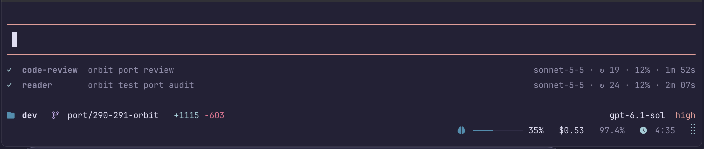

<p align="center">
  
</p>

<h1 align="center">dev-footer</h1>

<p align="center">A HUD footer for Pi, used by dev in a terminal that supports the Kitty protocol.</p>

## Install

Clone directly into Pi's global extension directory:

```sh
mkdir -p ~/.pi/agent/extensions
git clone https://github.com/taekwondodev/dev-footer.git ~/.pi/agent/extensions/dev-footer
```
